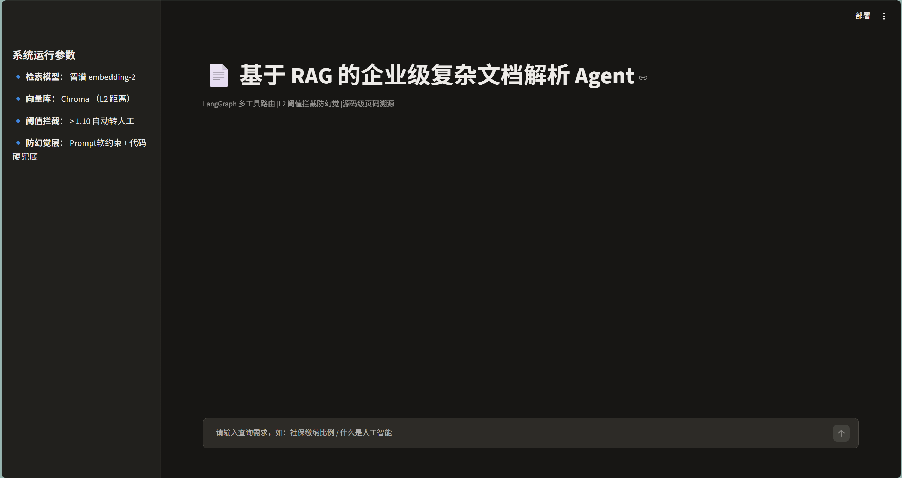
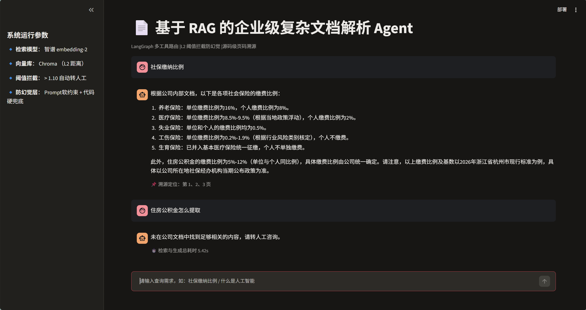

# 基于 RAG 的企业级复杂文档解析与检索 Agent (LangGraph)

> 面向企业级复杂文档（如 Datasheet、政策手册等）的智能问答系统。基于 LangGraph 多工具路由架构，提供高精度 RAG 检索、L2 阈值拦截、三层防幻觉兜底与源码级页码溯源能力。

## 项目背景与简介

在企业级场景（如硬件 Datasheet 提参、公司制度查询）中，大模型的“幻觉”是不可接受的。单纯堆砌 Prompt 无法解决复杂文档切分、工具路由错乱及恶意编造等问题。

本项目基于 LangGraph 开发，采用 ReAct 架构，支持 CLI 与 Streamlit Web 双端运行。除了常规的 RAG、百科与计算器工具外，项目重点攻克了检索边界判定与防幻觉拦截，确保系统在遇到无答案的问题时“敢拒答”，在面对有效问题时“答得准、可溯源”。

## 🖥️ 界面演示 (Demo)

> 核心验证场景对比：用户提问“社保缴纳比例”时，系统精准检索并附带程序化页码溯源；当提问“住房公积金怎么提取”时（文档未涉及该流程），系统触发 L2 距离阈值拦截，成功阻断大模型编造，安全转接人工。




## 核心特性

| 模块 | 亮点描述 |
|------|----------|
| 三层防幻觉架构 | Prompt 软约束 + 工具返回强指令 + 代码层硬兜底检测（拦截大模型盲目编造） |
| L2 距离阈值拦截 | 基于真实分数分布（0.82~1.28）设定阈值（1.10），低相关度直接触发拒答转人工 |
| 程序化页码溯源 | 不依赖大模型自觉，通过正则提取 ToolMessage 元数据，精准定位原文页码 |
| 工具路由纠正 | 穷举业务场景完善 Tool Docstring，解决 Agent 将公司制度误路由至 Wikipedia 的问题 |
| 索引签名自动重建 | 通过 PDF 的 mtime、size 及切分参数生成签名，参数变化自动重建 Chroma 向量库 |
| 双端交互支持 | 提供 CLI 命令行交互，以及基于 Streamlit 的专业 Web 对话界面 |
| 滑动窗口记忆 | 维护多轮对话上下文，自动裁剪至最近 10 轮，防止 Token 溢出 |

## 技术栈

- 核心框架：LangChain, LangGraph (ReAct Agent)
- 大语言模型：智谱 AI glm-4-flash (Temp=0)
- 向量与 Embedding：智谱 embedding-2 + Chroma 本地向量库
- 文档解析：PyPDFLoader (带页级乱码与文本质量检测)
- UI 框架：Streamlit
- 开发语言：Python 3.12

## 架构与工程设计

### 1. 检索与防幻觉链路
```text
用户提问 
  ↓ 
Agent 意图识别 (ReAct)
  ↓
调用 search_company_docs 工具 (Chroma 检索)
  ↓
判断 Top1 L2 距离是否 > 1.10 ? 
  ├── 是 (拒答) → 返回系统强指令 → LLM 拒绝回答
  │                              ↓ (代码硬兜底检测)
  │                        若 LLM 仍编造 → 强制替换为人工客服话术
  └── 否 (放行) → 注入带【来源·第X页】的上下文 → LLM 生成回答
                                                 ↓
                                           正则提取页码并展示
```

### 2. 复杂文档预处理流水线
- 页级质量检测：统计 PDF 页面替换字符率（`\ufffd`）与文本长度，标记疑似乱码/空页。
- 中文语义切分：使用 `RecursiveCharacterTextSplitter` 针对中文标点（`。`、`；`）进行优化，设 `chunk_size=400, overlap=100`，避免条款标题与数值被切断。

## 快速开始

### 1. 克隆项目与安装依赖
```bash
git clone <你的GitHub仓库地址>
cd multi-tool-ai-assistant
python3 -m venv graph_env
source graph_env/bin/activate
pip install -r requirements.txt
```

### 2. 配置环境变量
在项目根目录创建 `.env` 文件：
```bash
ZHIPU_API_KEY=你的智谱API密钥
```

### 3. 准备测试文档
将你的测试 PDF 文件命名为 `hr_policy.pdf`，放置在项目根目录。系统首次运行会自动解析并构建向量库。

### 4. 启动应用

方式一：Streamlit Web 界面（推荐）
```bash
streamlit run app.py
```
打开浏览器访问 `http://localhost:8501` 即可进行交互。

方式二：CLI 命令行模式
```bash
python smart_agent.py
```

## 回归测试用例（诊断证据）

项目内置了严格的回归测试标准，以验证防幻觉与路由机制是否生效：

| 测试场景 | 输入示例 | 预期表现 |
|---------|---------|---------|
| 正常RAG | `社保缴纳比例` | 输出五险一金比例，底部展示溯源定位页码（如：第 1、2、3 页） |
| 阈值拒答 | `住房公积金怎么提取` | 触发 L2 拦截（>1.10），输出系统拦截提示并转接人工咨询 |
| 路由纠正 | `什么是人工智能` | 正确调用 Wikipedia，而非走内部文档 RAG |
| 代码硬兜底 | 复杂拒答场景 | 若 LLM 无视工具拒答强行输出步骤，代码层将其强制覆盖为拒绝回复 |

## 项目结构

```text
.
├── app.py                  # Streamlit Web 界面
├── smart_agent.py          # Agent 核心逻辑与 CLI 入口
├── hr_policy.pdf           # 测试 PDF 文档
├── index_meta.json         # 向量库签名文件（自动生成）
├── memory.json             # CLI 记忆持久化（自动生成）
├── chroma_db_agent/        # 向量数据库持久化目录
├── requirements.txt        # 依赖清单
└── README.md
```

## 针对企业级 Datasheet 场景的扩展规划 (Future Work)

1. 表格与多模态解析：引入 `pdfplumber` 或 `LlamaParse` 将复杂表格转为 Markdown；针对图纸/引脚图引入 OCR/VLM 做图文联合提取。
2. 结构化提参校验：提取的器件参数需通过 Pydantic 等 Schema 校验后入库，彻底阻断模型胡乱生成未提取的参数。
3. 自定义 StateGraph 优化延迟：用自定义图替代完全自主的 ReAct 循环，对明确意图走“检索-生成”短路架构，降低多轮往返耗时。
4. 意图分流与鉴权：根据用户角色（部门）在 Chroma 检索前注入 Metadata Filter，实现行级权限控制。

## 作者

- GitHub: [@2730266616](https://github.com/2730266616)

## 许可证
本项目采用 MIT 许可证，详见 [LICENSE](LICENSE) 文件。

